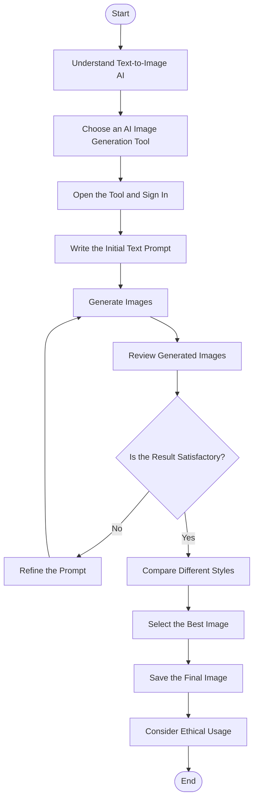

# Ex.No. 12 – Generating Images from Text Prompts Using a Generative AI Tool

## AIM

To understand how text-to-image generative AI works and to generate and refine sample images from text prompts using a free AI image-generation tool.

---

## INTRODUCTION

Generative Artificial Intelligence (Generative AI) is a branch of artificial intelligence that can create new content such as text, images, audio, video, and code based on user instructions.

One of the important applications of Generative AI is **Text-to-Image Generation**, where a written description is converted into a visual image. Users can describe an object, person, environment, artistic style, lighting condition, or scene, and the AI model generates an image based on the given description.

Text-to-image generation is useful in graphic design, education, advertising, digital art, entertainment, product visualisation, and creative content development.

This practical demonstrates how to select an AI image-generation tool, write effective prompts, generate images, refine the prompts, compare different artistic styles, and save the final output.

---

## WHAT IS TEXT-TO-IMAGE GENERATIVE AI?

Text-to-image generative AI is a technology that converts a written description, known as a **prompt**, into a newly generated image.

The AI model learns patterns and relationships between images and their descriptions during training. When a user enters a prompt, the model processes the description and generates an image that attempts to represent the requested subject, style, mood, lighting, and composition.

Unlike a traditional image search engine, which retrieves existing images, a text-to-image model generates new visual content based on learned patterns.

### Basic Working Principle

1. **Input Prompt:** The user enters a written description of the required image.
2. **Text Processing:** The AI model interprets the words and identifies the important concepts.
3. **Image Generation:** The model generates visual content based on the prompt.
4. **Output Image:** The generated image is displayed to the user.
5. **Prompt Refinement:** The user modifies the description to improve the result.

### Example

**Input Prompt:**

"A futuristic classroom with students using AI robots, digital art style."

**Expected Output:**

An AI-generated illustration showing a modern classroom with students interacting with intelligent robots and digital learning equipment.

---

## OBJECTIVES

- To understand the concept of text-to-image generative AI.
- To identify different AI-powered image-generation tools.
- To learn how to write effective text prompts.
- To generate images using written descriptions.
- To understand the importance of prompt refinement.
- To compare images generated using different artistic styles.
- To save and organise AI-generated images.
- To understand the ethical considerations involved in AI image generation.

---

## TOOLS REQUIRED

| S.No. | Tool / Requirement | Purpose |
|---|---|---|
| 1 | Bing Image Creator / Microsoft Designer | AI image generation |
| 2 | Adobe Firefly | Text-to-image generation |
| 3 | Canva AI | AI-powered visual creation |
| 4 | DALL·E in ChatGPT | Text-to-image generation |
| 5 | Web browser | Accessing the AI tool |
| 6 | Microsoft or Google account | Signing in, if required |
| 7 | Internet connection | Communicating with the AI service |
| 8 | Local storage | Saving generated images |

**Note:** The tools listed above are alternatives. It is not necessary to use all of them. Availability, free usage limits, and account requirements may vary depending on the platform.

---

## IMPORTANT PROMPT COMPONENTS

A good text-to-image prompt should clearly describe the image that the user wants to generate.

The following components help improve prompt quality.

| Component | Description | Example |
|---|---|---|
| Subject | Main object or focus of the image | Futuristic classroom |
| Environment | Background or surroundings | Modern smart campus |
| Action | Activity performed by the subject | Students interacting with robots |
| Style | Artistic appearance | Digital art, cartoon, oil painting |
| Lighting | Type of illumination | Warm lighting, cinematic lighting |
| Colour | Dominant colours or colour mood | Blue and purple tones |
| Composition | Arrangement of objects | Wide-angle view |
| Quality | Desired visual detail | Highly detailed, sharp focus |

### General Prompt Formula

A useful prompt structure is:

`Subject + Environment + Action + Style + Lighting + Colour + Composition`

**Example:**

"A futuristic classroom with students interacting with AI-powered robots, modern smart campus environment, vibrant digital art style, warm lighting, blue and purple colour palette, wide-angle view, highly detailed."

The more clearly the important visual elements are described, the better the AI can interpret the user's intention. However, adding unnecessary details can sometimes make the result confusing.

---

## PROCEDURE

### Step 1: Understanding Text-to-Image Generative AI

Before generating an image, understand that the AI is not simply searching for an existing picture. It uses patterns learned during training to create new visual content based on the words in the prompt.

The user provides a textual description, and the AI model interprets the description to generate a corresponding image.

Important concepts include:

- **Prompt:** Textual instruction provided to the AI.
- **Generative Model:** An AI model that produces new content.
- **Image Output:** The visual result generated by the model.
- **Prompt Refinement:** Modifying the prompt to improve the generated result.

### Step 2: Choosing an Image-Generation Tool

1. Open a web browser such as Google Chrome or Microsoft Edge.
2. Select a text-to-image AI tool.
3. Open the official website of the selected platform.
4. Sign in using the required account, if necessary.
5. Navigate to the image-generation feature.
6. Locate the prompt input box.

**Examples of available platforms:**

- Microsoft Designer: https://designer.microsoft.com/
- Adobe Firefly: https://firefly.adobe.com/
- Canva: https://www.canva.com/
- ChatGPT: https://chatgpt.com/

<image-placeholder>

</image-placeholder>

### Step 3: Writing a Simple First Prompt

Enter a short and clear description of the required image in the prompt input box.

**Example Prompt:**

"A futuristic classroom with students using AI robots, digital art style."

The prompt should clearly identify the main subject and the intended visual appearance.

After entering the prompt, check the spelling and ensure that the description communicates the desired scene.

### Step 4: Generating and Reviewing the First Set of Images

1. Click the **Generate** button.
2. Wait while the AI model processes the prompt.
3. Review the generated image options.
4. Observe how the AI interpreted the description.
5. Compare the images based on subject accuracy, composition, colour, and visual quality.

Depending on the selected platform, the tool may generate one or multiple image options.

The first generation provides a baseline for understanding how the AI responds to the prompt.

### Step 5: Refining the Prompt for a Better Result

After reviewing the initial images, modify the prompt by adding more descriptive details.

**Original Prompt:**

"A futuristic classroom with students using AI robots, digital art style."

**Refined Prompt:**

"A futuristic classroom with students interacting with advanced AI-powered robots, vibrant digital art, warm cinematic lighting, blue and purple colour palette, wide-angle view, highly detailed modern educational environment."

1. Return to the prompt input box.
2. Add details about lighting, colour, environment, or camera angle.
3. Keep the main subject unchanged.
4. Click **Generate** again.
5. Compare the new results with the original images.

Prompt refinement helps the user understand how additional descriptive words influence the generated image.

### Step 6: Comparing Different Style Keywords

Keep the main subject the same but change the artistic style keywords.

Generate images using the following prompts:

**Prompt 1 – Oil Painting Style**

"A futuristic classroom with students interacting with AI robots, traditional oil painting style."

**Prompt 2 – Cartoon Style**

"A futuristic classroom with students interacting with AI robots, colourful cartoon illustration style."

**Prompt 3 – Photorealistic Style**

"A futuristic classroom with students interacting with AI robots, photorealistic style, realistic lighting and detailed textures."

Compare the generated images to understand how the style keyword changes the visual appearance.

| Style | Expected Visual Appearance |
|---|---|
| Oil Painting | Brush strokes, artistic textures, painted appearance |
| Cartoon | Simplified shapes, colourful illustrations, animated appearance |
| Photorealistic | Realistic lighting, textures, and object details |
| Digital Art | Computer-generated artistic appearance |

### Step 7: Saving the Final Image

1. Review all generated images.
2. Select the image that best matches the original requirement.
3. Open the selected image.
4. Click the **Download** or **Save** option.
5. Select a suitable file format, if available.
6. Save the image to the computer.
7. Rename the image with a meaningful filename.

**Example filename:**

`futuristic_ai_classroom.png`

The final image can be used in the practical report, academic presentation, or project documentation, subject to the platform's usage terms.

### Step 8: Noting Ethical Considerations

AI image generation should be used responsibly.

The following ethical considerations should be observed:

1. **Privacy:** Avoid generating or sharing images of identifiable real people without appropriate permission.
2. **Copyright:** Check the platform's terms and applicable copyright rules before using generated images commercially.
3. **Transparency:** Disclose when an image is AI-generated, especially in academic or professional work.
4. **Misinformation:** Do not use AI-generated images to create misleading or deceptive content.
5. **Bias and Fairness:** Be aware that generated images may reflect biases present in training data.
6. **Responsible Usage:** Avoid generating harmful, discriminatory, or misleading visual content.

---

## WORKFLOW DIAGRAM

The following flowchart represents the complete text-to-image generation process.

---

## PROMPT REFINEMENT AND COMPARISON

Prompt refinement is the process of modifying a written description to obtain a more accurate or visually appealing image.

The following table demonstrates how a simple prompt can be improved step by step.

| Iteration | Prompt | Main Improvement |
|---|---|---|
| 1 | A futuristic classroom | Defines the main subject |
| 2 | A futuristic classroom with students using AI robots | Adds subjects and activity |
| 3 | A futuristic classroom with students using AI robots, vibrant digital art, warm lighting | Adds style and lighting |
| 4 | A futuristic classroom with students interacting with advanced AI robots, vibrant digital art, warm cinematic lighting, blue and purple colours, wide-angle view | Adds colour and composition details |

### Observations

- The first prompt provides only a basic description.
- The second prompt introduces additional objects and activities.
- The third prompt adds visual style and lighting.
- The fourth prompt provides a more detailed visual description.
- Different style keywords can produce noticeably different results.

**Note:** These are example prompts and expected observations. Actual generated images may vary depending on the AI tool and model.

---

## SAMPLE OUTPUT SCREEN

The screen below shows a sample text-to-image generator, with the prompt entered and four generated results ready to compare and save.

---

## SAMPLE GENERATED IMAGE

**Prompt Used:**

"A futuristic classroom with students using AI robots, vibrant digital art style, warm lighting, blue and purple colour palette, wide-angle view."

**Expected Output:**

An illustration of a modern classroom containing students, AI-powered robots, interactive digital displays, and advanced educational technology.

---

## OBSERVATIONS

| S.No. | Experiment Activity | Observation |
|---|---|---|
| 1 | Entering the initial prompt | The AI generated images based on the given description. |
| 2 | Adding more descriptive details | The generated images reflected the additional prompt details to varying degrees. |
| 3 | Changing the artistic style | The visual appearance changed according to the selected style keyword. |
| 4 | Regenerating the image | Different results were produced from modified prompts. |
| 5 | Selecting the final image | The most suitable image was selected and saved. |

---

## ADVANTAGES OF TEXT-TO-IMAGE GENERATIVE AI

1. **Easy to Use:** Users can generate images using simple written descriptions.
2. **Saves Time:** Reduces the time required to create visual concepts manually.
3. **Creative Exploration:** Allows users to experiment with different artistic styles.
4. **Accessibility:** Makes image creation available to people without advanced drawing skills.
5. **Rapid Prototyping:** Helps designers and developers visualise ideas quickly.
6. **Customisation:** Images can be refined by modifying the text prompt.
7. **Multiple Applications:** Useful in education, advertising, entertainment, and product design.

---

## LIMITATIONS OF TEXT-TO-IMAGE GENERATIVE AI

1. **Prompt Dependency:** Poorly written prompts may produce unexpected results.
2. **Inaccurate Details:** Generated images may contain distorted objects, text, or proportions.
3. **Limited Control:** The output may not exactly match the user's intention.
4. **Usage Restrictions:** Free image-generation tools may have daily limits or generation restrictions.
5. **Ethical Concerns:** Generated images can be misused to create misleading content.
6. **Copyright Uncertainty:** The rights and permitted uses of generated images depend on the platform and applicable law.
7. **Inconsistent Results:** The same prompt may generate different images on different attempts.

---

## APPLICATIONS OF TEXT-TO-IMAGE GENERATIVE AI

- **Education:** Creating visual learning materials and illustrations.
- **Graphic Design:** Generating design concepts, posters, and digital artwork.
- **Advertising:** Creating visual ideas for marketing campaigns.
- **Entertainment:** Developing concept art for games, films, and animation.
- **Architecture:** Visualising building and interior design concepts.
- **Product Design:** Creating early-stage product concepts.
- **Social Media:** Generating creative visual content.
- **Research and Development:** Supporting visualisation of proposed ideas and concepts.

---

## FUTURE ENHANCEMENTS

The experiment can be extended by:

1. Comparing multiple AI image-generation platforms using the same prompt.
2. Experimenting with negative prompts, where supported by the selected tool.
3. Generating images with different aspect ratios and resolutions.
4. Exploring image-to-image generation.
5. Using reference images to guide image generation, where supported.
6. Testing prompts for engineering, architecture, and scientific visualisation.
7. Comparing the accuracy and consistency of different AI-generated outputs.
8. Exploring image editing and inpainting features.

---

## OUTPUT

A set of AI-generated images was produced from a written prompt and refined across multiple prompt iterations. Different artistic styles were compared, and the final selected image was saved for use in the report.

---

## RESULT

Thus, text-to-image generative AI was successfully explored by writing, testing, and refining prompts, and a final AI-generated image was produced and saved.

---

## CONCLUSION

In conclusion, text-to-image generative AI demonstrates how descriptive language can be converted into visual content using artificial intelligence. The experiment shows that prompt wording, including the subject, style, lighting, colour, and level of detail, has a major influence on the generated result.

By experimenting with different prompts and refining the descriptions, users can improve the relevance and visual quality of generated images. This practical provides an understanding of prompt engineering, creative AI applications, and the importance of using generative AI tools ethically and responsibly.

---

## REFERENCES

1. Microsoft Designer – https://designer.microsoft.com/
2. Adobe Firefly – https://firefly.adobe.com/
3. Canva – https://www.canva.com/
4. OpenAI – https://openai.com/
5. OpenAI Help Center – https://help.openai.com/
6. Google Cloud – Generative AI Concepts – https://cloud.google.com/learn/what-is-generative-ai

---
